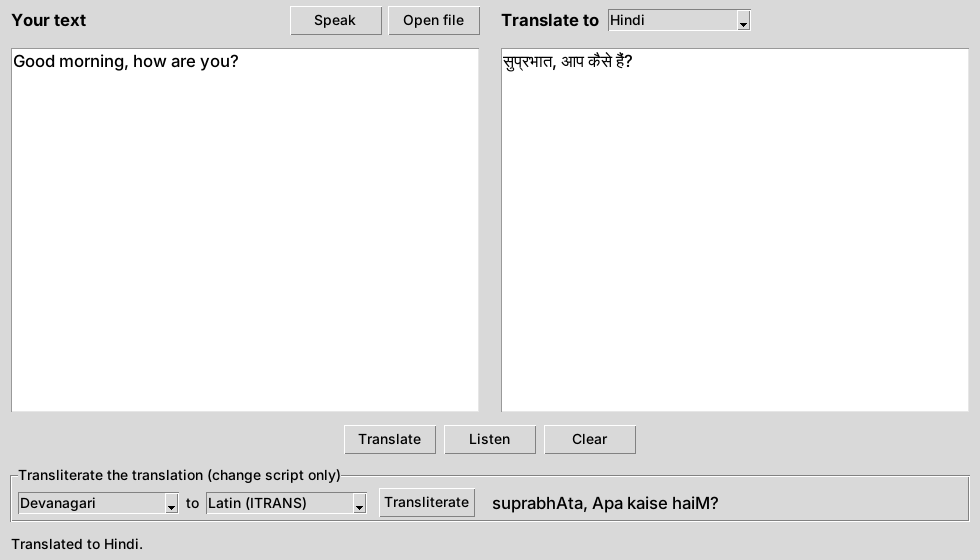

# Multilingual Translator & Transliterator

Translate text, files or speech between English and nine Indian languages, then read the result in Latin letters or hear it spoken. Comes as a desktop app and a command-line tool.




## Features

- **Translate** between English, Hindi, Telugu, Tamil, Kannada, Malayalam, Marathi, Bengali, Gujarati and Punjabi
- **Transliterate** between ten scripts (Devanagari, Telugu, Tamil and others, plus Latin), so "सुप्रभात" becomes "suprabhAta" without changing the language
- **Three ways to input text**: type it, open a `.txt` or `.pdf` file, or speak into the microphone
- **Listen** to the translation with Google Text-to-Speech
- **Desktop app and command line** share the same core, so both behave the same

## How it works

```
 text / .txt / .pdf / microphone
              │
              ▼
     translator_core.py ──── translate()      → Google Translate (deep-translator)
              │          ├── transliterate()  → indic-transliteration (offline)
              │          ├── read_text_file() → pypdf for PDFs
              │          └── speak()          → gTTS, saved as translation.mp3
              ▼
       app.py (Tkinter)   ·   translate.py (command line)
```

All logic lives in `translator_core.py`, with no UI code, so it can be tested on its own. The translation backend is passed in as a function, which lets tests swap in an offline stand-in.

## Run it

```bash
git clone https://github.com/ramya036/multilingual-translator.git
cd multilingual-translator
pip install -r requirements.txt
```

**Desktop app**

```bash
python app.py
```

**Command line**

```bash
python translate.py "Good morning, how are you?" --to Hindi --romanize
# सुप्रभात, आप कैसे हैं?
# suprabhAta, Apa kaise haiM?

python translate.py --file notes.pdf --to Tamil --speak
python translate.py "नमस्ते" --transliterate Devanagari Telugu
# నమస్తే
```

Translation and speech need an internet connection; transliteration works offline. On macOS or Linux, PyAudio (for the microphone) may need `brew install portaudio` or `sudo apt install portaudio19-dev` first.

## Tests

```bash
pip install -r requirements-dev.txt
pytest
```

16 tests cover language lookup, translation with an offline stand-in, transliteration across scripts, romanizing translations, reading `.txt` and `.pdf` files, saving speech, and the command-line options. GitHub Actions runs them on every push.

## Project structure

| File | Description |
|---|---|
| `translator_core.py` | Translation, transliteration, file reading and speech, with no UI code |
| `app.py` | Tkinter desktop app |
| `translate.py` | Command-line tool |
| `tests/` | pytest suite |
| `docs/app.png` | Screenshot |
